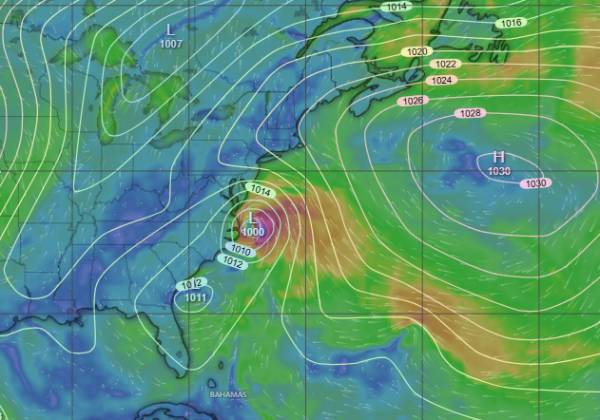
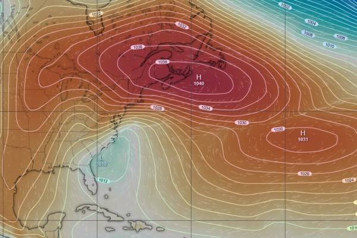
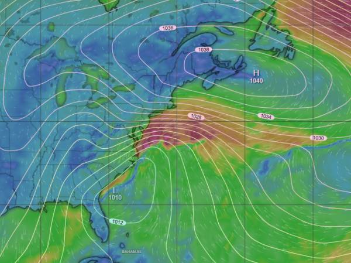
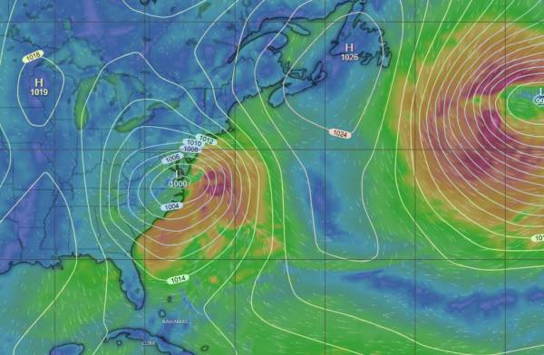
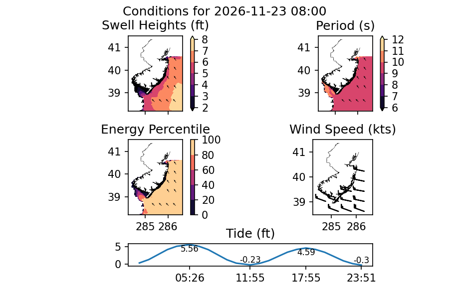
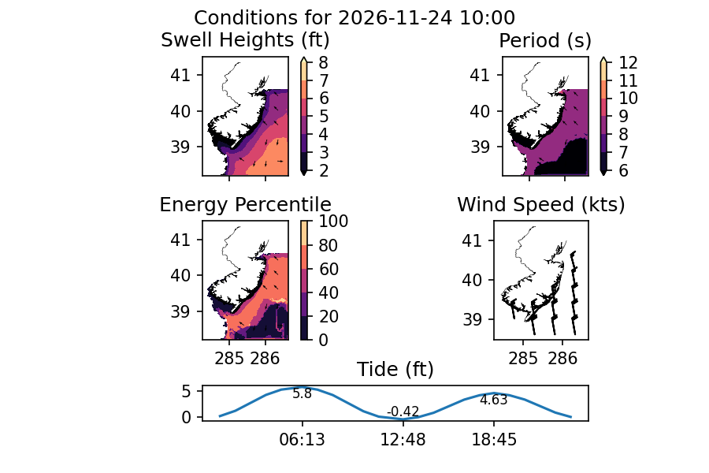

*Things are looking exciting over the next few weeks*

---

## Waves for Thanksgiving Week

Currently, we are looking at a very active week for Thanksgiving, starting with a potential subtropical storm that is expected to impact our region on Sunday/Monday.

On the upside, one of those impacts is potentially solid surf with an offshore wind switch. Unfortunately, there will be some negatives as well, namely coastal flooding due to rain and a deep high tide due to the full moon expected on 11/24.

After this southeast swell, we could see a Nor'easter on Wednesday with a potential cleanup on Thanksgiving Day.

Models are even predicting another storm for the weekend (around Sunday).

## A Look at the Charts

Let's first look at the wind charts for each of these days:

**11/20 ECMWF Wind**

source: windy.com

While this isn't a crazy strong low, it's really well placed to interact with high pressure that was over our region for the past week and send a southeast swell to our region.

Conveniently, and against what I previously expected, this system is expected to stay pretty close to the coast (worse for flooding and wind damage). The upside to this storm track is a better chance of an offshore wind switch behind this system as it passes our region overnight Sunday, potentially setting up the best surf we've seen in quite some time.

Expect around 1-2 inches of rain if the forecast holds and prepare for flooding if you live in a flood plain.

**11/25**

source: windy.com (pressure chart)

source: windy.com (wind chart)

Another, very strong region of high pressure follows quickly behind this weekend's coastal low. This is expected to set up as a dome of high pressure centered over the Canadian Maritimes. A coastal low is expected to form off the Carolinas or North Florida and track up the coast as a Nor'easter. Due to the dome of high pressure, this would be an east swell as you can see on the wind chart.

It's pretty far out, but models are predicting a storm track that would be favorable for an offshore wind switch. Essentially, that strong high pressure keeps the system from exiting to the east and up against the coastline. There is still plenty of time for this to change, but, for now, it looks good (for surf at least).

Expect a fair amount of rain from this system if it comes to pass.

**11/29**

Week high pressure moves through on Saturday and sets up over the West Atlantic. A region of low pressure tracks across the southern half of the U.S. and could organize over GA or the Carolinas. This setup would have a high probability of creating a south swell if it occurs. I'm pretty optimistic that this could happen even though it's over a week out.

### Surf Forecast for 11/23

Currently, 11/22 looks pretty bad. I was originally hoping we'd see some frontrunner swell before the wind turned onshore (or at least stayed light). As of right now, I'm less optimistic about that. I'd still keep an eye on Sunday late AM or so, but low expectations.

Monday on the other hand, looks about as good as I've seen in quite some time.

The dropping tide on Monday morning looks to start off with head high+ surf and favorable wind. Beginners should sit this one out, but for the more experienced folks, this looks like a really fun swell!

Size fades a bit, but should remain chest+ into the evening.

## Surf Forecast for 11/24

Models are currently calling for leftovers on Tuesday. Based on the more recent model runs, I'm more optimistic for this than I was prior. The wind switch looks to be more WNW for Monday and not as strong of winds as I was originally seeing. This means less size should be lost overnight and conditions should remain cleaner than the northerly wind switch I was seeing earlier would have provided.

While there should be some leftovers, the AM session is definitely the one to target for both the most size and best wind. Wind should get more out of the north as the day goes on for deteriorating conditions.

Watch the wind forecast closely as this could still change.

