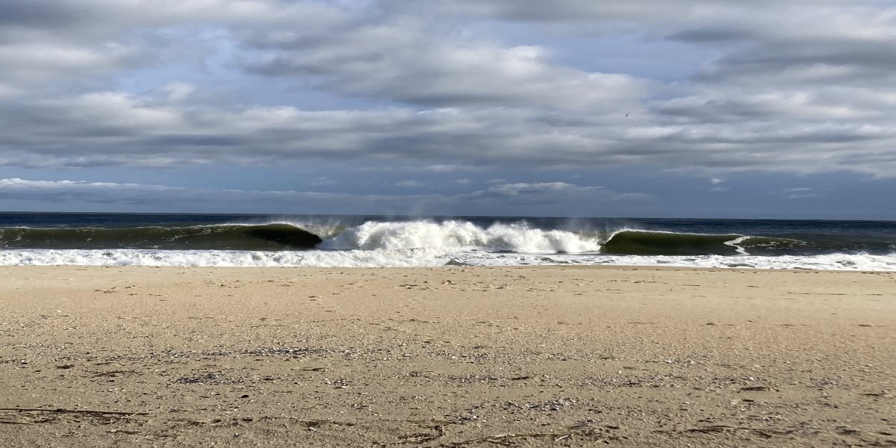

**Last Update:  11/13/2026 09:00** (Next update likely around 11/18)

**Link to Free Surf Cams:** [Beach Cams](https://thesurfersview.com/live-cams/new-jersey/)

---

## Forecast for 11/11 - 11/20

The updated storm track is more favorable for swell production but wind still looks to be an issue. North wind protected spots could be worth a look on Friday afternoon. Surf fades significantly overnight but Saturday AM should be worth a look as well.

We're mostly looking at sustained offshore flow as the southern half of this low pressure system moves out of our region. A large region of high pressure moves in afterwards and keeps things looking pretty slow.

It's possible we could see a coastal low late next week (~11/19), but that's certainly not a sure thing.

Models have been suggesting a swell around 11/23 pretty consistently. Hopefully we see something then.

---

### Friday 11/13

| Time   |   Wave Direction |   Swell Height |   Period |   Energy Percentile | Wind Direction   |   Wind Speed |   Water Level |
|:-------|-----------------:|---------------:|---------:|--------------------:|:-----------------|-------------:|--------------:|
| 06:00  |               75 |            5.9 |      7.1 |                62   | NNE              |         19.3 |           1.5 |
| 08:00  |               75 |            6.8 |      7   |                68.9 | NNE              |         23.6 |           3.1 |
| 10:00  |               75 |            7.9 |      7.3 |                77.8 | N                |         26.7 |           3.3 |
| 12:00  |               75 |            8.3 |      7.6 |                82.4 | N                |         27.6 |           1.8 |
| 14:00  |               75 |            8.3 |      7.8 |                84.7 | N                |         26.8 |           0.2 |
| 16:00  |               75 |            8   |      7.9 |                83.9 | N                |         24.4 |          -0.4 |
| 18:00  |               75 |            7.4 |      7.9 |                82.1 | N                |         21.4 |           0.3 |

**Prediction for NY Harbor Buoy**

| Time   |   Angle 1 |   Swell 1 |   Period 1 |   Angle 2 |   Swell 2 |   Period 2 |   WW Angle |   Wind Wave |   WW Period |
|:-------|----------:|----------:|-----------:|----------:|----------:|-----------:|-----------:|------------:|------------:|
| 07:00  |     174.1 |       1.1 |        7.4 |     113.7 |       0.2 |       12   |       63   |         6.3 |         6.4 |
| 13:00  |      88.2 |       5.1 |        7.8 |     172.2 |       1.7 |        7.4 |       21.9 |         3.2 |         4.4 |
| 19:00  |      86.8 |       4.1 |        7.8 |     176.4 |       1.2 |        7.8 |        3.2 |         2.3 |         3.7 |

**Prediction for Barnegat Light Buoy**

| Time   |   Angle 1 |   Swell 1 |   Period 1 |   Angle 2 |   Swell 2 |   Period 2 |   WW Angle |   Wind Wave |   WW Period |
|:-------|----------:|----------:|-----------:|----------:|----------:|-----------:|-----------:|------------:|------------:|
| 07:00  |     173.1 |       2   |        7.2 |      92.8 |       0.3 |       12   |       45.5 |         7.5 |         6.6 |
| 13:00  |     175.1 |       1.6 |        7.2 |     170.3 |       1.4 |        7.1 |       54.4 |         7.1 |         7.9 |
| 19:00  |      70.8 |       5.2 |        7.9 |     177.2 |       1.1 |        7.4 |      355.6 |         2.5 |         4   |

| Time   | Tide   |   Height (ft) |
|:-------|:-------|--------------:|
| 02:53  | L      |          0.83 |
| 09:17  | H      |          4.64 |
| 15:40  | L      |          0.59 |
| 21:56  | H      |          3.71 |

Significant difference from earlier model runs. Originally, buoy numbers were around 2ft at 8 seconds and now we're looking at 4-5ft at 8 seconds.

Wind is strong north for poor conditions in Monmouth County.

Swell is expected to fade quickly overnight/Saturday.

Notes: Significantly more swell than earlier model runs were suggesting. Watch end of day and Saturday.

### Saturday 11/14

| Time   |   Wave Direction |   Swell Height |   Period |   Energy Percentile | Wind Direction   |   Wind Speed |   Water Level |
|:-------|-----------------:|---------------:|---------:|--------------------:|:-----------------|-------------:|--------------:|
| 06:00  |             75   |            4.5 |      7.4 |                53.9 | NW               |         16.6 |           0.2 |
| 08:00  |             75   |            4.3 |      7.3 |                49.8 | NW               |         17.6 |           1.8 |
| 10:00  |             75   |            4.3 |      7.2 |                47.8 | NW               |         20   |           2.3 |
| 12:00  |             75   |            4.2 |      7.2 |                45.9 | NW               |         20.2 |           1.3 |
| 14:00  |             75   |            4.1 |      5   |                14.6 | NW               |         20.9 |          -0.1 |
| 16:00  |            282.6 |            4.1 |      4.2 |                 0   | WNW              |         22.2 |          -1.2 |
| 18:00  |            347.6 |            4   |      4.2 |                 0.2 | WNW              |         21.1 |          -0.9 |

**Prediction for NY Harbor Buoy**

| Time   |   Angle 1 |   Swell 1 |   Period 1 |   Angle 2 |   Swell 2 |   Period 2 |   Angle 3 |   Swell 3 |   Period 3 |   WW Angle |   Wind Wave |   WW Period |
|:-------|----------:|----------:|-----------:|----------:|----------:|-----------:|----------:|----------:|-----------:|-----------:|------------:|------------:|
| 07:00  |      87.4 |       2.3 |        7.3 |     172.9 |       0.8 |        7.6 |       0   |       0   |        0   |      331.5 |         1.7 |         3.1 |
| 13:00  |      87   |       1.6 |        7   |     173.1 |       0.6 |        7.2 |     116.5 |       0.2 |       12.9 |      314.8 |         2.8 |         4   |
| 19:00  |      86.6 |       1   |        6.7 |     172   |       0.5 |        6.9 |     113.2 |       0.3 |       12.6 |      309.2 |         3.6 |         4.4 |

**Prediction for Barnegat Light Buoy**

| Time   |   Angle 1 |   Swell 1 |   Period 1 |   Angle 2 |   Swell 2 |   Period 2 |   Angle 3 |   Swell 3 |   Period 3 |   WW Angle |   Wind Wave |   WW Period |
|:-------|----------:|----------:|-----------:|----------:|----------:|-----------:|----------:|----------:|-----------:|-----------:|------------:|------------:|
| 07:00  |      76.3 |       3.1 |        7.5 |     173.2 |       0.7 |        7.3 |       0   |       0   |        0   |      338.5 |         2.5 |         3.7 |
| 13:00  |      77   |       2.2 |        7.2 |     172.1 |       0.6 |        6.9 |      97.4 |       0.2 |       13.3 |      324.7 |         3   |         4   |
| 19:00  |      75.9 |       1.5 |        6.9 |     170   |       0.5 |        6.8 |      90.7 |       0.3 |       12.6 |      317.1 |         3.8 |         4.5 |

| Time   | Tide   |   Height (ft) |
|:-------|:-------|--------------:|
| 03:29  | L      |          1.03 |
| 10:02  | H      |          4.42 |
| 16:21  | L      |          0.76 |
| 22:48  | H      |          3.6  |

Definitely an upgrade from earlier model runs. Waist high waves or so for Monmouth County with larger surf expected further south. Side offshore wind expected but stronger than we'd like to see given the swell numbers.

### Sunday 11/15

| Time   |   Wave Direction |   Swell Height |   Period |   Energy Percentile | Wind Direction   |   Wind Speed |   Water Level |
|:-------|-----------------:|---------------:|---------:|--------------------:|:-----------------|-------------:|--------------:|
| 06:00  |            345   |            3.3 |      3.9 |                   0 | WNW              |         19.7 |          -1   |
| 08:00  |            347.6 |            3.3 |      3.9 |                   0 | NW               |         19.1 |           0.4 |
| 10:00  |            354.7 |            3   |      4   |                   0 | NW               |         16.3 |           1.3 |
| 12:00  |            355   |            2.8 |      3.9 |                   0 | NW               |         15.6 |           0.9 |
| 14:00  |            355   |            2.6 |      3.8 |                   0 | NW               |         15.6 |          -0.3 |
| 16:00  |            355   |            2.6 |      3.8 |                   0 | NW               |         15.7 |          -1.4 |
| 18:00  |            355   |            2.5 |      3.8 |                   0 | NW               |         14.9 |          -1.7 |

Very Flat with strong offshore winds.

### Monday 11/16

| Time   |   Wave Direction |   Swell Height |   Period |   Energy Percentile | Wind Direction   |   Wind Speed |   Water Level |
|:-------|-----------------:|---------------:|---------:|--------------------:|:-----------------|-------------:|--------------:|
| 06:00  |            264.7 |            1.9 |      3.6 |                 0   | NW               |         12.1 |          -1.4 |
| 08:00  |            264.7 |            1.9 |      3.5 |                 0   | NNW              |         12.1 |          -0.3 |
| 10:00  |             12   |            1.9 |      3.5 |                 0   | NNW              |         12   |           0.9 |
| 12:00  |              5   |            1.7 |      3.5 |                 0   | NW               |         10.6 |           1.1 |
| 14:00  |            264.7 |            1.6 |      3.4 |                 0   | NW               |          9.5 |           0.1 |
| 16:00  |            264.7 |            1.5 |      5   |                 0   | NW               |          9   |          -1.1 |
| 18:00  |              5   |            1.5 |      9.9 |                 5.3 | NW               |          9.1 |          -1.8 |

| Time   | Tide   |   Height (ft) |
|:-------|:-------|--------------:|
| 04:59  | L      |          1.38 |
| 11:43  | H      |          4.15 |
| 18:03  | L      |          0.93 |

Flat

### Tuesday 11/17

| Time   |   Wave Direction |   Swell Height |   Period |   Energy Percentile | Wind Direction   |   Wind Speed |   Water Level |
|:-------|-----------------:|---------------:|---------:|--------------------:|:-----------------|-------------:|--------------:|
| 06:00  |            264.7 |            1.4 |      8.5 |                 0   | NW               |          7.9 |          -1.5 |
| 08:00  |            264.7 |            1.4 |      8.3 |                 0   | NW               |          7.9 |          -0.9 |
| 10:00  |            155   |            1.4 |      8.2 |                 8.1 | WNW              |          8   |           0.3 |
| 12:00  |            155   |            1.3 |      8.1 |                 7.5 | WNW              |          6.9 |           1   |
| 14:00  |            155   |            1.3 |      8.1 |                 6.6 | WNW              |          5   |           0.6 |
| 16:00  |            155   |            1.2 |      8   |                 5.6 | WNW              |          5   |          -0.6 |
| 18:00  |            155   |            1.2 |      8   |                 5.1 | WNW              |          5.9 |          -1.7 |

| Time   | Tide   |   Height (ft) |
|:-------|:-------|--------------:|
| 00:28  | H      |          3.66 |
| 06:08  | L      |          1.44 |
| 12:33  | H      |          4.11 |
| 19:01  | L      |          0.87 |

Flat

### Wednesday 11/18

| Time   |   Wave Direction |   Swell Height |   Period |   Energy Percentile | Wind Direction   |   Wind Speed |   Water Level |
|:-------|-----------------:|---------------:|---------:|--------------------:|:-----------------|-------------:|--------------:|
| 06:00  |            155   |            1.3 |      7.6 |                 4.8 | NW               |          8.4 |          -1.4 |
| 08:00  |            155   |            1.3 |      7.5 |                 4.7 | NW               |          7.9 |          -1.7 |
| 10:00  |            155   |            1.3 |      7.5 |                 4.4 | NW               |          6.8 |          -0.7 |
| 12:00  |            152.4 |            1.3 |      7.5 |                 4.4 | WNW              |          5.9 |           0.5 |
| 14:00  |            152.4 |            1.2 |      7.5 |                 4.1 | WNW              |          5   |           0.7 |
| 16:00  |            145   |            1.2 |      7.5 |                 4.4 | W                |          4   |          -0.3 |
| 18:00  |            145   |            1.2 |      7.5 |                 4.1 | W                |          4.3 |          -1.4 |

| Time   | Tide   |   Height (ft) |
|:-------|:-------|--------------:|
| 01:15  | H      |          3.82 |
| 07:22  | L      |          1.34 |
| 13:23  | H      |          4.1  |
| 19:54  | L      |          0.71 |
Flat

---

All data sourced from NOAA NWPS/GFS Wave and NOAA Tides and Currents

---

Current list of Surf Hazards
[Surf Hazards](/pages/surf_hazards)

---

Why Energy Percentile?
[Energy Article](/2025/10/08/Energy-Not-Predictive)

---

### Helpful Links

[Seasonal Sandbar Formation](https://www.youtube.com/watch?v=O6ZhTQQk-3s)

[NOAA Atlantic Analysis](https://ocean.weather.gov/Atl_tab.php)

#### Buoys

[NOAA New York Harbor Entrance Buoy](https://www.ndbc.noaa.gov/station_page.php?station=44065)

[Barnegat NJ Buoy](https://www.ndbc.noaa.gov/station_page.php?station=44091)

#### Bacteria Analysis

[Surfrider Foundation Blue Water Task Force](https://bwtf.surfrider.org/explore)

Sometimes I get something weird with that link, but it's correct.

[NJ DEP Beach Monitoring Program (Summer Only)](https://njbeaches.org/)

Both of the above are interactive maps.

#### Hurricane Analysis

[NHS 7 Day Outlook](https://www.nhc.noaa.gov/gtwo.php?basin=atlc&fdays=7)

[NHS Tropical Hazards Outlook](https://www.cpc.ncep.noaa.gov/products/precip/CWlink/ghaz/index.php)

#### Teleconnections

[NAO](https://www.cpc.ncep.noaa.gov/products/precip/CWlink/pna/nao.shtml)

[ENSO Diagnostic Discussion](https://www.cpc.ncep.noaa.gov/products/analysis_monitoring/enso_advisory/ensodisc.shtml)