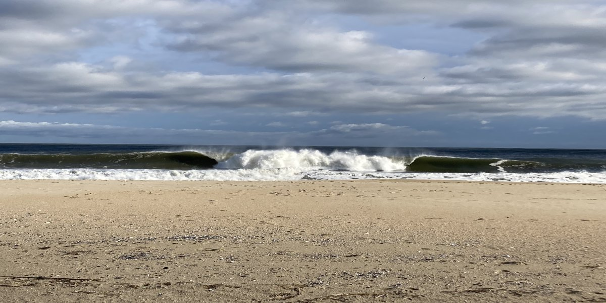

**Last Update:  11/20/2026 12:00**

**Link to Free Surf Cams:** [Beach Cams](https://thesurfersview.com/live-cams/new-jersey/)

---

## Forecast for 11/20 - 11/26

After a very flat week, we have a lot to look forward to over the next two weeks. This active period kicks off this weekend with a coastal low/potential subtropical storm that is expected to start sending swell on Sunday 11/22. Wind is likely a factor with moderately strong onshores expected to arrive around the same time the waves do.

Early week currently looks like the window to target, with side-offshore or even offshore winds expected for Monday. Definitely a day to target for really good quality surf. I'd expect head-overhead surf for the early AM that fades to chest-head for the afternoon.

Click [here](/2026/11/20/Active-Period-Begins) for an in depth forecast for Thanksgiving week.

---

### Tuesday 11/17 - Saturday 11/21

Flat

### Sunday 11/22

Click [here](/2026/11/20/Active-Period-Begins) for an in depth forecast for Thanksgiving week.

| Time   |   Wave Direction |   Swell Height |   Period |   Energy Percentile | Wind Direction   |   Wind Speed |   Water Level |
|:-------|-----------------:|---------------:|---------:|--------------------:|:-----------------|-------------:|--------------:|
| 06:00  |            155   |            2.1 |      8.8 |                26.5 | E                |          8   |           1.9 |
| 08:00  |            155   |            2.4 |      9   |                33.2 | E                |         10   |           0.2 |
| 10:00  |            155   |            2.8 |      9.1 |                42.5 | E                |         11.8 |          -1.6 |
| 12:00  |            155   |            3.3 |      9.1 |                51.3 | E                |         12.8 |          -1.9 |
| 14:00  |            164.7 |            3.9 |      8.9 |                54   | E                |         13.9 |          -0.2 |
| 16:00  |            165   |            4.6 |      8.9 |                61.7 | E                |         14.9 |           1.7 |
| 18:00  |            165   |            5.5 |      9.2 |                73.9 | ENE              |         14.7 |           2.1 |

**Prediction for NY Harbor Buoy**

| Time   |   Angle 1 |   Swell 1 |   Period 1 |   Angle 2 |   Swell 2 |   Period 2 |   WW Angle |   Wind Wave |   WW Period |
|:-------|----------:|----------:|-----------:|----------:|----------:|-----------:|-----------:|------------:|------------:|
| 07:00  |     153.5 |       1.6 |        9   |       0   |       0   |        0   |      110.4 |         0.9 |         2.6 |
| 13:00  |     156.1 |       2.1 |        9.2 |       0   |       0   |        0   |       91.8 |         2   |         3.3 |
| 19:00  |     155.4 |       4.3 |        9.5 |      90.7 |       2.7 |        4.8 |       16.1 |         2.7 |         4   |

**Prediction for Barnegat Light Buoy**

| Time   |   Angle 1 |   Swell 1 |   Period 1 |   Angle 2 |   Swell 2 |   Period 2 |   WW Angle |   Wind Wave |   WW Period |
|:-------|----------:|----------:|-----------:|----------:|----------:|-----------:|-----------:|------------:|------------:|
| 07:00  |     151.4 |       1.9 |        9.1 |      89.1 |       0.2 |       12.1 |      106.2 |         1.2 |         2.9 |
| 13:00  |     152.6 |       3.2 |        9   |      89.6 |       0.2 |       12   |       80.8 |         2.2 |         3.6 |
| 19:00  |     150.6 |       7.3 |       11.9 |       0   |       0   |        0   |       37.4 |         5.2 |         5.2 |

| Time   | Tide   |   Height (ft) |
|:-------|:-------|--------------:|
| 04:38  | H      |          5.2  |
| 11:04  | L      |          0.04 |
| 17:06  | H      |          4.47 |
| 23:02  | L      |         -0.17 |

Building swell with poor winds expected. There may be a small window where there is enough surf with light enough onshore winds, but I have pretty low expectations for Sunday as a whole.

Notes: Watch the wind forecast carefully.

Best board: something that handles choppy conditions

### Monday 11/23

Click [here](/2026/11/20/Active-Period-Begins) for an in depth forecast for Thanksgiving week.

| Time   |   Wave Direction |   Swell Height |   Period |   Energy Percentile | Wind Direction   |   Wind Speed |   Water Level |
|:-------|-----------------:|---------------:|---------:|--------------------:|:-----------------|-------------:|--------------:|
| 06:00  |              145 |            6.9 |      9.8 |                90.1 | W                |         12.2 |           2.7 |
| 08:00  |              145 |            6.3 |      9.7 |                87.1 | WNW              |         12.2 |           0.9 |
| 10:00  |              145 |            5.8 |      9.4 |                83.4 | WNW              |         12.4 |          -1.3 |
| 12:00  |              135 |            5.5 |      9.3 |                82.2 | WNW              |         11   |          -2.5 |
| 14:00  |              135 |            5.3 |      9.1 |                79.7 | WNW              |         10   |          -1.6 |
| 16:00  |              135 |            5   |      9.1 |                77.3 | WNW              |         10.2 |           0.3 |
| 18:00  |              135 |            4.8 |      9   |                75.1 | NW               |         11.7 |           1.4 |

**Prediction for NY Harbor Buoy**

| Time   |   Angle 1 |   Swell 1 |   Period 1 |   WW Angle |   Wind Wave |   WW Period |
|:-------|----------:|----------:|-----------:|-----------:|------------:|------------:|
| 07:00  |     144.2 |       6.1 |        9.7 |      273.3 |         1.4 |         3   |
| 13:00  |     141.3 |       5.1 |        9.3 |      290.7 |         1.2 |         2.8 |
| 19:00  |     138.9 |       4.3 |        9   |      323.8 |         2.8 |         3.9 |

**Prediction for Barnegat Light Buoy**

| Time   |   Angle 1 |   Swell 1 |   Period 1 |   WW Angle |   Wind Wave |   WW Period |
|:-------|----------:|----------:|-----------:|-----------:|------------:|------------:|
| 07:00  |     136.2 |       6.2 |        9.6 |      287.3 |         1.3 |         2.8 |
| 13:00  |     134   |       5.2 |        9.2 |        0   |         0   |         0   |
| 19:00  |     132   |       4.5 |        9   |      340.2 |         2.4 |         3.7 |

| Time   | Tide   |   Height (ft) |
|:-------|:-------|--------------:|
| 05:26  | H      |          5.56 |
| 11:55  | L      |         -0.23 |
| 17:55  | H      |          4.59 |
| 23:51  | L      |         -0.3  |

Looks really good! Beginners should avoid the AM session and use know their limits for the afternoon.

### Tuesday 11/24

| Time   |   Wave Direction |   Swell Height |   Period |   Energy Percentile | Wind Direction   |   Wind Speed |   Water Level |
|:-------|-----------------:|---------------:|---------:|--------------------:|:-----------------|-------------:|--------------:|
| 06:00  |              135 |            4.5 |      8.6 |                68.5 | NNW              |         15.4 |           2.8 |
| 08:00  |              135 |            4.4 |      8.6 |                66.7 | NNW              |         15.4 |           1.9 |
| 10:00  |              135 |            4.3 |      8.5 |                65.1 | N                |         15   |          -0.4 |
| 12:00  |              135 |            4.2 |      8.5 |                63.5 | NNW              |         14   |          -2.5 |
| 14:00  |              135 |            4   |      8.6 |                62.4 | NNW              |         12.1 |          -2.2 |
| 16:00  |              135 |            3.9 |      8.8 |                62.7 | N                |         12   |          -0.3 |
| 18:00  |              135 |            3.9 |      9   |                65.1 | N                |         12.6 |           1.5 |

**Prediction for NY Harbor Buoy**

| Time   |   Angle 1 |   Swell 1 |   Period 1 |   WW Angle |   Wind Wave |   WW Period |
|:-------|----------:|----------:|-----------:|-----------:|------------:|------------:|
| 07:00  |     136.5 |       3.3 |        8.6 |       18.8 |         1.6 |         3.2 |
| 13:00  |     134.7 |       3.1 |        8.5 |       27.6 |         1.6 |         3.5 |
| 19:00  |     131.8 |       3   |        9.2 |       30   |         1.5 |         2.8 |

**Prediction for Barnegat Light Buoy**

| Time   |   Angle 1 |   Swell 1 |   Period 1 |   WW Angle |   Wind Wave |   WW Period |
|:-------|----------:|----------:|-----------:|-----------:|------------:|------------:|
| 07:00  |     129.6 |       3.4 |        8.6 |       18.5 |         1.9 |         4   |
| 13:00  |     126.9 |       3.2 |        8.6 |       36.7 |         2.2 |         4.4 |
| 19:00  |     123   |       3.2 |        9.3 |       37.2 |         1.5 |         3.9 |

| Time   | Tide   |   Height (ft) |
|:-------|:-------|--------------:|
| 06:13  | H      |          5.8  |
| 12:48  | L      |         -0.42 |
| 18:45  | H      |          4.63 |

Possible leftovers. As of right now, this looks pretty likely. Wind could be a factor.

Notes: Uncertain this far out; check back later.

### Wednesday 11/25

| Time   |   Wave Direction |   Swell Height |   Period |   Energy Percentile | Wind Direction   |   Wind Speed |   Water Level |
|:-------|-----------------:|---------------:|---------:|--------------------:|:-----------------|-------------:|--------------:|
| 06:00  |            125   |            5   |      9.7 |                83   | NE               |         18   |           2.7 |
| 08:00  |             86.1 |            5.1 |      9.7 |                83.9 | NE               |         18   |           2.9 |
| 10:00  |             75   |            5.3 |      5.4 |                30.1 | ENE              |         19   |           0.7 |
| 12:00  |             85   |            5.4 |      5.6 |                36   | ENE              |         18.9 |          -1.7 |
| 14:00  |             95   |            5.5 |      5.8 |                41.1 | ENE              |         19.3 |          -2.4 |
| 16:00  |            105   |            6   |      6.3 |                55   | ENE              |         21.1 |          -0.8 |
| 18:00  |            105   |            6.6 |      6.9 |                68.3 | ENE              |         22.7 |           1.3 |

| Time   | Tide   |   Height (ft) |
|:-------|:-------|--------------:|
| 00:43  | L      |         -0.37 |
| 07:01  | H      |          5.88 |
| 13:40  | L      |         -0.52 |
| 19:36  | H      |          4.61 |

A new swell is expected (possible Nor'easter). While it's far out, models have been picking up on a signal that there should be an active pattern during this time period.

### Thursday 11/26 - Weekend

Watching this time period closely; check back later.

*Another* swell may follow late weekend into early week. Lots to look forward to!

---

All data sourced from NOAA NWPS/GFS Wave and NOAA Tides and Currents

---

Current list of Surf Hazards
[Surf Hazards](/pages/surf_hazards)

---

Why Energy Percentile?
[Energy Article](/2025/10/08/Energy-Not-Predictive)

---

### Helpful Links

[Seasonal Sandbar Formation](https://www.youtube.com/watch?v=O6ZhTQQk-3s)

[NOAA Atlantic Analysis](https://ocean.weather.gov/Atl_tab.php)

#### Buoys

[NOAA New York Harbor Entrance Buoy](https://www.ndbc.noaa.gov/station_page.php?station=44065)

[Barnegat NJ Buoy](https://www.ndbc.noaa.gov/station_page.php?station=44091)

#### Bacteria Analysis

[Surfrider Foundation Blue Water Task Force](https://bwtf.surfrider.org/explore)

Sometimes I get something weird with that link, but it's correct.

[NJ DEP Beach Monitoring Program (Summer Only)](https://njbeaches.org/)

Both of the above are interactive maps.

#### Hurricane Analysis

[NHS 7 Day Outlook](https://www.nhc.noaa.gov/gtwo.php?basin=atlc&fdays=7)

[NHS Tropical Hazards Outlook](https://www.cpc.ncep.noaa.gov/products/precip/CWlink/ghaz/index.php)

#### Teleconnections

[NAO](https://www.cpc.ncep.noaa.gov/products/precip/CWlink/pna/nao.shtml)

[ENSO Diagnostic Discussion](https://www.cpc.ncep.noaa.gov/products/analysis_monitoring/enso_advisory/ensodisc.shtml)